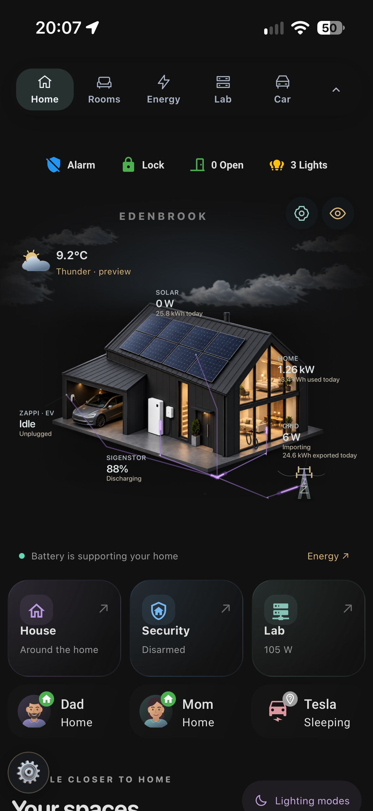
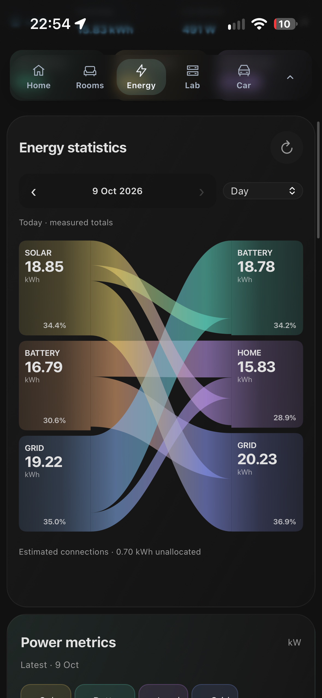
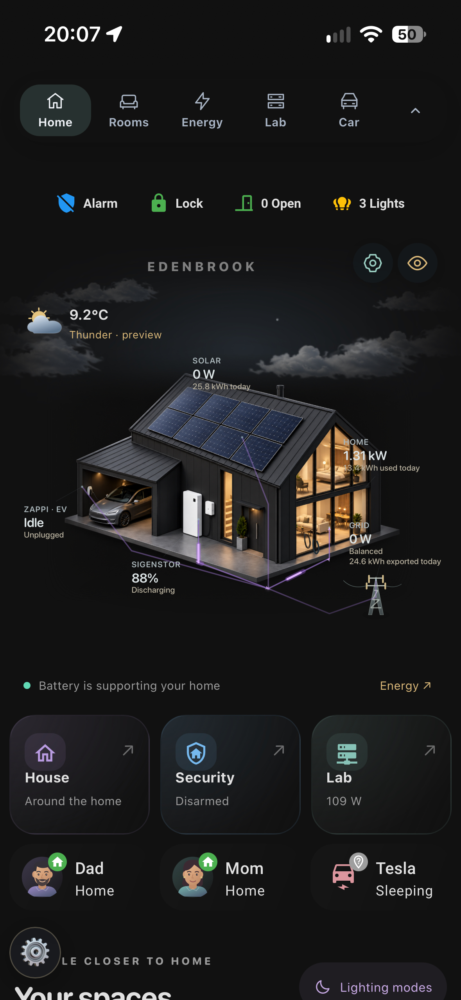
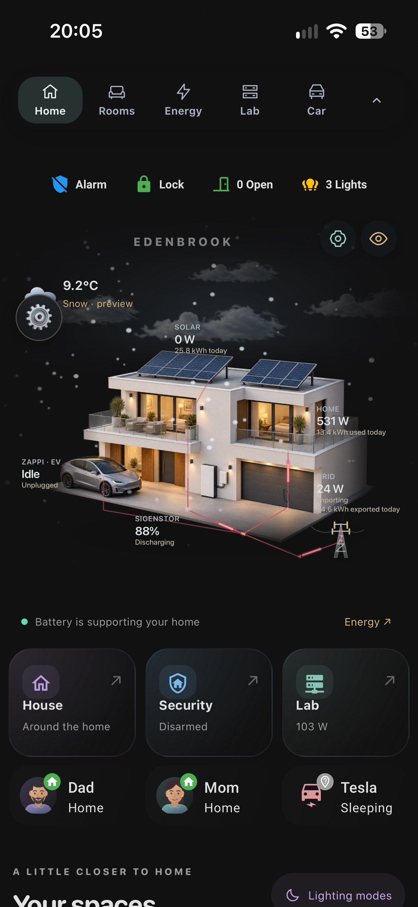
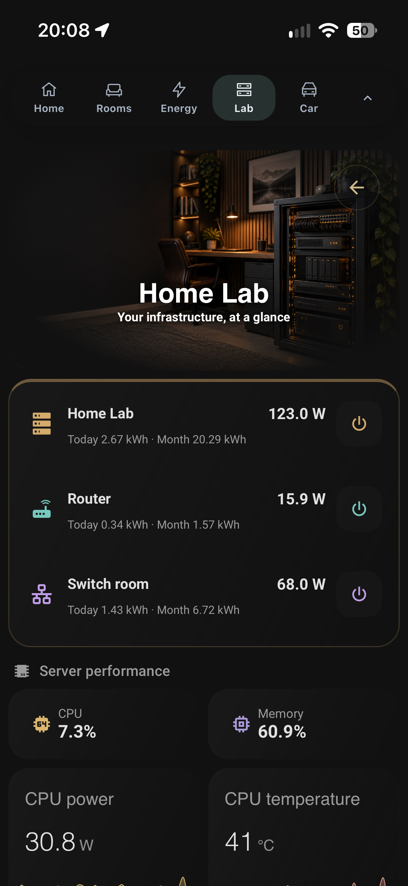
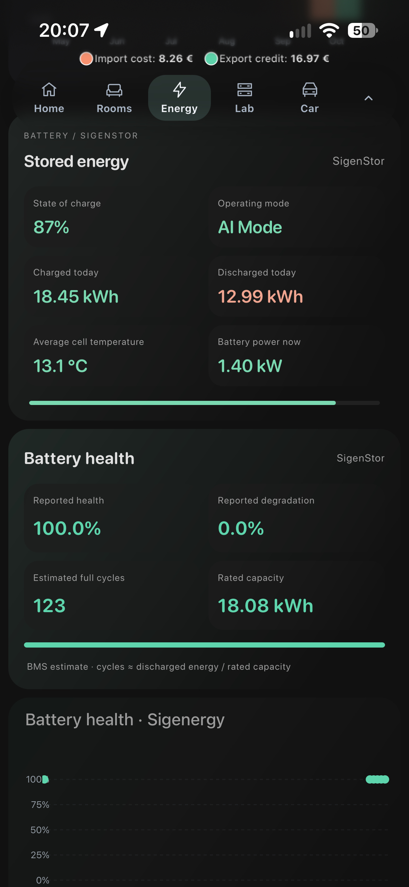

# MyHome — Home Assistant dashboard

A mobile-first dashboard with 30 views: animated home and weather scenes, rooms,
energy statistics, forecast comparison, power metrics, appliances, security,
home lab, car, lighting modes and house climate. Exported from the live dashboard
on 17 October 2026, with personal identifiers replaced by public examples.

This is a **dashboard reference and frontend bundle**, not a one-click replacement
for your HA installation. The artwork and layout are included; your integrations,
entities, helpers, automations and history supply the data. Missing data is not
invented. Features such as heating controls, laundry reminders and learned energy
baselines need corresponding backend entities and scripts.

## Which repository should I use?

- **[Original dashboard — sanitised reference](https://github.com/narayanvs/homeassistant-dashboard):** this repository. The full layout and frontend from my actual home, with personal details replaced. It needs your own entities, integrations and backend routines.
- **[Mobile Dashboard Starter — generic demo and setup wizard](https://github.com/narayanvs/mobile-dashboard-starter):** start here for a HACS beta, visual setup, automatic discovery and labelled demo data. It is the easier way to build your own dashboard.

## Start here

**Please don’t copy and paste the whole dashboard as-is.** It was built around
one household’s devices, entity names and automations. Use it as a visual
reference, rather than expecting everything to work unchanged.

The approach I recommend is to connect your own Home Assistant to an AI assistant
through Home Assistant MCP, then ask it to build a similar-looking dashboard
using the integrations and entities you actually have. Share screenshots or point
it at the cards you like, start with one page and refine it together. Keep a backup
and ask it to verify entities and controls before making changes.

For example:

> Use this repository as design inspiration. Inspect my Home Assistant entities
> and integrations, then create a separate mobile dashboard with a similar style.
> Start with Home and one room, keep my existing dashboard, and don’t invent data
> or change my automations without discussing it first.

You can also adapt the files manually; the steps below explain how.

## Screenshots

These existing examples retain Edenbrook branding and ordinary dashboard readings.
All nine were visually reviewed; no private names, precise locations, credentials
or camera imagery were visible. Image metadata has been stripped. They illustrate
an earlier revision, so some cards differ from the current export.

| Home | Energy flow | Energy statistics |
|:---:|:---:|:---:|
|  |  |  |
|  |  |  |
|  |  |  |

## Using this dashboard

This is a personal dashboard shared for inspiration and adaptation, rather than a
maintained HACS project or a plug-and-play package. Use the whole layout or borrow
the cards you like. There is no installer or automatic setup wizard.

1. Install the third-party cards listed in `resources/resources.json` through
   HACS. Their `/hacsfiles/` URLs are references; vendor code is not bundled.
   **washing-machine-card** is required by the appliance wrappers.
2. Copy `custom-cards/` to `/config/www/custom-cards/`. Register one JavaScript
   Module resource: `/local/custom-cards/myhome-dashboard.js?rev=20261017`. It imports the
   custom modules and their dependencies. Use the resource list as a checklist;
   do not replace your existing resource registry.
3. Copy the contents of `images/` into `/config/www/`, preserving the directories
   so the `/local/` image paths resolve correctly.
4. Create a new dashboard with URL `dashboard-myhome`, take control, then paste
   `dashboard/home-dashboard.yaml` into its raw configuration editor. Keep your
   existing dashboard while adapting this one. The export uses JSON syntax,
   which is valid YAML 1.2 and preserves embedded JS/Jinja strings.
5. Replace example entity IDs with your own. Look in both the dashboard file and
   `custom-cards/`: some custom cards have defaults or construct IDs from prefixes.
   `resources/entity-requirements.json` groups the literal references by domain.
   Creating a dashboard does not create its helpers, scripts or automations.

### Tips for adapting it

- **Start small:** keep Home and one room first. Remove pages and controls you do
  not need, then add energy, appliances and other sections as their data is ready.
- **Check the data, not just the name:** replacement sensors need compatible units,
  attributes and meaning. Power in W is different from energy in kWh; daily totals
  are different from lifetime counters. History graphs also need recorded data.
- **Keep navigation consistent:** if you choose another dashboard URL, replace
  `dashboard-myhome` in the dashboard configuration and custom scripts.
- **Keep dependencies together:** copy the whole custom-cards directory initially.
  Some cards inherit from other modules, even when the parent is not visible.
- **Verify controls:** map the room lights, mode scripts and climate entities
  before testing their buttons. Remove controls for features you do not have.
- **Expect empty sections:** appliance and attention strips auto-hide when there
  is nothing to display. Missing backend entities can also leave cards empty.
- **Refresh after updates:** if a card still looks old, refresh the HA frontend or
  clear its frontend cache. Avoid loading old and new copies of the same module.
- **Try it on your phone:** check scrolling and tap targets on the device you use.
  Keep heavy graphs lower down and avoid adding unnecessary animated cards.
- **Keep your adapted copy private:** do not publish your real entity identifiers,
  credentials, location details, camera images or raw HA configuration by accident.

Appearance uses theme variables and browser-local presets. Adjust your HA theme
and the scene's appearance controls before changing individual card colors.

### Latest dashboard refinements

- Compact two-column Lighting Modes controls with distinct automatic/manual awake
  and resting states, readable room labels and phone-sized controls.
- Family calendar with month, week, day and agenda views, horizontally scrolling
  calendar filters and a compact Home summary. Configure your own writable HA
  calendar entities; no events or personal calendar identifiers are included.
- Shared, theme-aware appliance artwork, including distinct washer/dryer animation,
  wall-mounted TV, gaming PC and dual-monitor desk; animation pauses off-screen.
- Room wake-up and Holiday & Away controls reference existing backend routines.
  Those routines are not installed by copying this dashboard.
- Expanded Energy panels for meter history, tariff bands, supplier gas and folding
  sections. These require the matching data schema and supplier integrations.
- Browser-local font selection and a compact, draggable floating Appearance menu.

- Compact icon-only floating navigation, including Appliances, with hide/show.
- Expanded Home Lab panels with resource rings, network and radio diagnostics.
- Appearance presets now reach room controls, activity timelines, appliance icons
  and forecast card backgrounds. Chart series retain their distinct colours.
- A folded Sensor health summary and active override countdowns on House.
  Lighting pause controls auto-hide in rooms when inactive. Ending a pause makes
  the existing automation eligible again; it does not force heating or lights on.
- Appliance animations pause off-screen, and security events refresh only while
  the event card is visible.

Sensor checks use the explicitly configured readings: unavailable values, low
batteries and temperature reports older than six hours. Adjust the monitored
entities and reporting threshold for your devices. Old reports are a prompt to
check a sensor, not proof it is offline; healthy sensors may report infrequently.
Countdown controls require your existing HA timers and automation logic.

### Backend-dependent features

- **Energy:** inverter power and cumulative energy, recorder/statistics history,
  solar forecast, and compatible flow-allocation entities. Historical attribution
  cannot be reconstructed accurately from daily totals alone.
- **Energy learning:** a compatible learning backend and its attributes. The
  source installation's private custom integration is not included here.
- **Rooms / lighting / heating:** your presence sensors, dedicated temperature
  sensors, mode helpers, timers and control scripts. Copying the dashboard alone
  does not create their automation logic.
- **Appliances:** power readings plus cycle tracking helpers; dishwasher telemetry
  where available. The auto-hiding Home strip can legitimately be empty.
- **Security:** your own authenticated camera/Frigate integration and event access.
  No snapshots, event records, network shares or camera credentials are included.
- **Lab / car:** the corresponding integrations and your mapped entities.

The entity list covers literal references, not every dynamically constructed ID.
Some cards also expect specific attribute schemas. Adapt these against your own
integrations; matching an entity ID alone does not guarantee matching behavior.

### If Home Assistant says a custom card is missing

A card type such as `custom:myhome-preset-live-v1` is a JavaScript element name,
**not a file to download with that name**. This one is defined in
`custom-cards/appearance-presets.js` and inherits the house scene from other
modules. Copy the entire `custom-cards/` folder and register the single entry
point `/local/custom-cards/myhome-dashboard.js?rev=20261017`, after installing the
third-party prerequisites. Loading only one file may leave its parent missing.

If you already copied an older export, update the whole folder, check that the
entry-point URL has the current revision, then reload the frontend. Keep the
revision on imports and resources consistent. The validator checks that every
bundled card type used by the dashboard has a provider reachable from the loader.

## Included files and previously missing dependencies

| Feature / former filename | Current provider |
|---|---|
| `myhome-preset-live-v1` | `appearance-presets.js` → house scene modules; loaded by `myhome-dashboard.js` |
| `myhome-cycle-stable-v2` | `appliance-cycle.js` → `appliance-animation.js`, `cycle-card.js` and third-party washing-machine-card |
| `myhome-energy-facts-v2`, `myhome-energy-usage-v2` | `energy-components.js` |
| `myhome-energy-overview-v5` (current view uses v6) | `energy-overview-controls.js` → `energy-overview-core.js`, `energy-components.js` |
| `myhome-quiet-live-v27` | `house-scene.js` and its weather/scene bases |
| `myhome-comet-v26.js` | `energy-flow-animation.js` → `energy-flow-colours.js` and weather modules |

JS filenames are stable, without version suffixes; custom-element identifiers keep
versions for compatibility. All local import paths resolve within the bundle. Resource and import URLs share
`?rev=20261017` for cache invalidation; keep these in step when updating files.
Do not load the entry point alongside separately registered copies with different
revision URLs. The URL revision is not part of the filename.
The image assets include house variants, cloud texture, transparent car artwork,
room art, banners and generic resident illustrations.

## Privacy checks

The current dashboard configuration and scripts contain no resident names, original household branding,
charger serial, account email entity ID, private hosts/IPs, credentials, configured
coordinates, camera snapshots or recorded entity states. Identifiers for people
and the alarm are generic examples. Room and integration entity IDs remain as
examples to make adaptation practical.

PNG text, EXIF and provenance metadata has been removed without changing pixels.
SVG metadata/comments were removed. The phone screenshots retain approved Edenbrook branding and ordinary usage readings;
see the visual review note above. Artwork is illustrative; it is not a photograph
of the source household.

Run the repeatable checks before sharing changes:

```sh
python3 tools/validate.py
```

This checks common secret patterns, metadata, local imports/assets, resource paths
and navigation. It is one safeguard, not proof that arbitrary future content is
safe. Visually inspect screenshots before adding them. Never commit your private
adaptations, raw HA exports, backups or `.storage` data.
**Earlier Git commits are separate from this sanitized working tree**: deleting a
file in a new commit does not remove its old versions from Git history.

## License

Shared as-is for reference. Adapt freely to your own Home Assistant setup.
Third-party cards retain their respective licenses and are installed separately.
