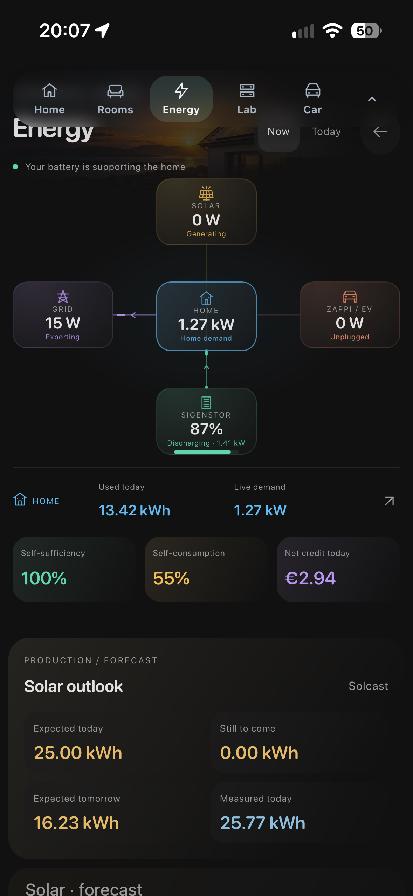
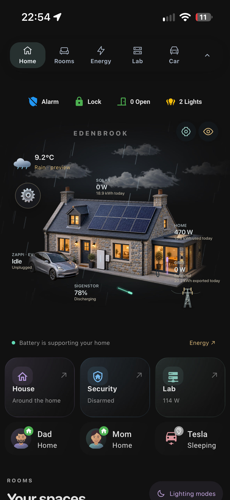
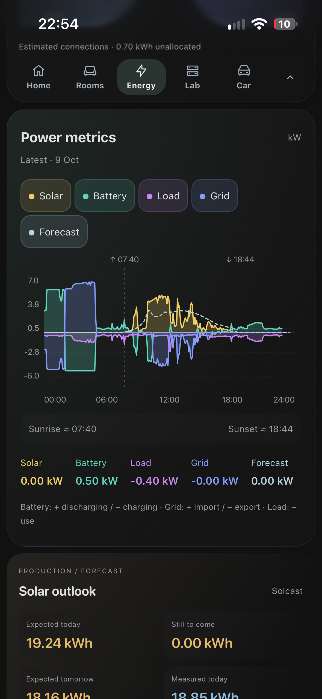

# Home Assistant — Home Dashboard

A custom Home Assistant dashboard (28 views) built around Mushroom, Bubble Card,
button-card, ApexCharts and a set of bespoke custom cards (energy flow, room
consoles, weather, EV, speedtest, appliance cycles). Shared publicly as a
reference/example.

## Screenshots

| | | |
|:---:|:---:|:---:|
|  |  |  |
|  |  |  |
|  |  |  |

> **Sanitized for public sharing.** All personal data has been removed or
> replaced with placeholders (see **Sanitization** below). You will need to
> adapt entity IDs, areas and resource paths to your own setup.

## Structure

```
HA_Dashboard/
├── dashboard/
│   └── home-dashboard.yaml      # the full dashboard config (28 views)
├── custom-cards/                # 19 bespoke custom cards (ES modules)
│   ├── myhome-room-console-v3.js
│   ├── myhome-energy-overview-v5.js
│   ├── myhome-tesla-v4.js
│   └── ... (see folder)
├── resources/
│   └── resources.json           # Lovelace resource registry (HACS + /local modules)
├── images/                      # referenced artwork (room icons, banners, avatars)
│   ├── myhome-room-icons-v1/
│   ├── myhome-rooms-v1/  myhome-rooms-v3/
│   ├── myhome-dashboard-banners/
│   └── myhome-scene-v1/         # resident avatar SVGs (generic illustrations)
└── README.md
```

## Requirements (HACS cards used)

Install these via HACS (referenced in `resources/resources.json`):
Mushroom, Bubble Card, button-card, auto-entities, ApexCharts Card,
mini-graph-card, vertical-stack-in-card, card-mod, kiosk-mode,
swipe-navigation, power-flow-card-plus, energy-flow-card-plus, clock-weather-card,
mini-media-player, vacuum-card, better-thermostat-ui-card, LG WebOS Remote Control,
ha-sankey-chart, washing-machine-card.

The `myhome-*` cards in `custom-cards/` are custom — copy them to
`/config/www/custom-cards/` and register each as a `module` resource
(`/local/custom-cards/<file>.js`). Images go under `/config/www/` matching the
`/local/...` paths in the YAML.

## Setup (outline)

1. Install the HACS cards above.
2. Copy `custom-cards/*.js` to `config/www/custom-cards/` and register them as
   dashboard resources (type: JavaScript Module).
3. Copy `images/*` to `config/www/` preserving the folder names.
4. Create a new dashboard (storage mode), take control, and paste
   `dashboard/home-dashboard.yaml` as the raw config.
5. **Replace the placeholder entity IDs with your own** — the dashboard
   references entities named for a specific setup (Sigen inverter, Zappi EV
   charger, Reolink/Frigate cameras, a Tesla, Shelly/Tasmota switches, etc.).

## Sanitization

The following were replaced before publishing — none of these are present in
any file:

- **Household/branding name** → `myhome` (all casings).
- **Resident names** → `person.resident_1` / `person.resident_2`, display
  labels → `Resident 1` / `Resident 2`; avatar SVGs → `resident-1-avatar` /
  `resident-2-avatar` (the avatars are generic vector illustrations — no
  photos, faces or names).
- **Device serial** (EV charger) → zeroed.
- Verified **absent**: IP addresses, hostnames (DuckDNS / Nabu Casa / `.local`),
  e-mail addresses, API keys / passwords / tokens / bearer / client secrets,
  webhook IDs, GPS coordinates. The dashboard never embedded any of these.

> Note: the AI-generated room/banner images carry a `trufo.ai` content-provenance
> watermark (a C2PA signature indicating the artwork was AI-generated). This is a
> tool marker, not personal data.

## License

Shared as-is for reference. Adapt freely to your own Home Assistant setup.
