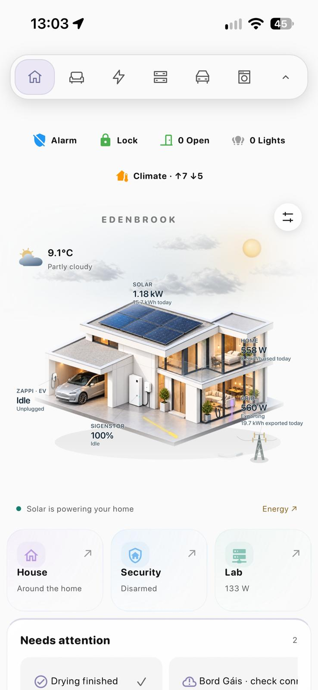
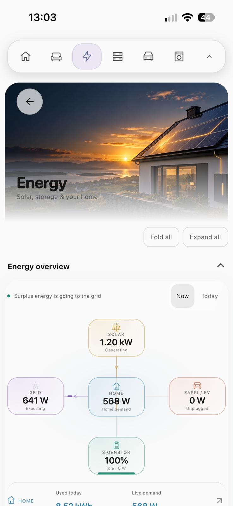
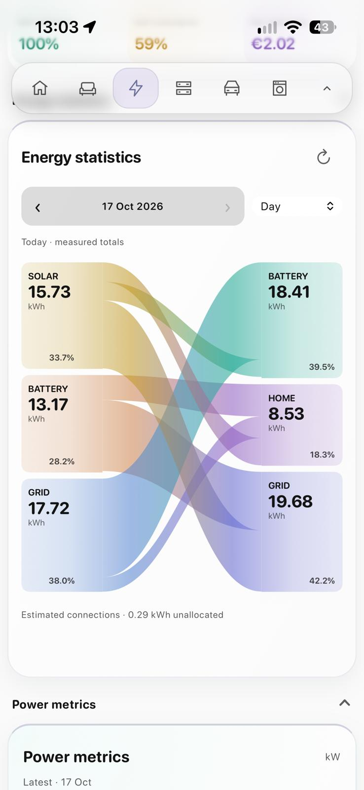
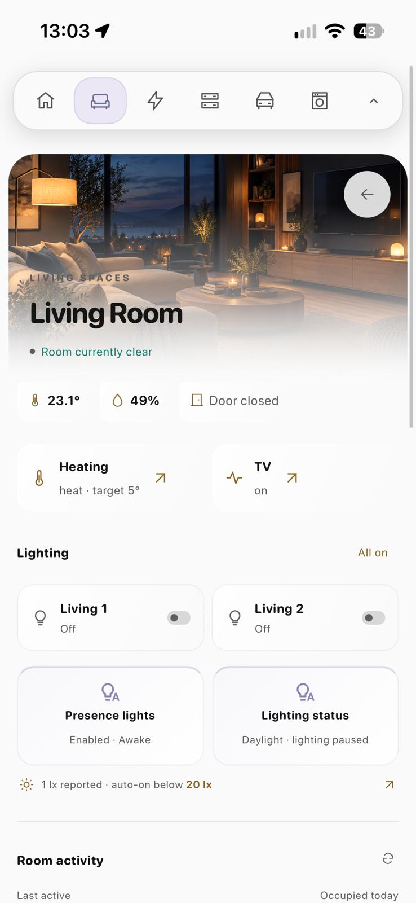
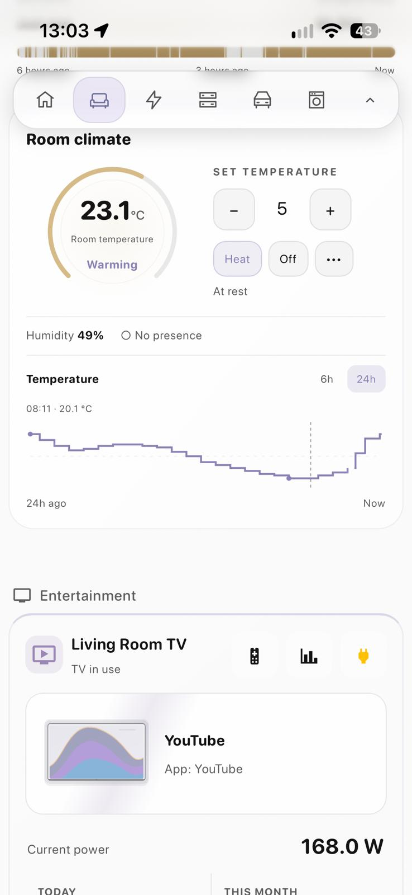

# Screenshot gallery

[Back to the README](../README.md) · [Light mode](#light-mode--reference-dashboard) · [Dark mode](#dark-mode)

Screenshots show the actual dashboard with ordinary readings and approved Edenbrook
branding. Dark examples are from an earlier revision; some cards have since changed.

Images have been reviewed and stripped of metadata. Tap an image for full size.
Animations appear still in screenshots.

## Light mode — reference dashboard

These show the actual reference dashboard with its configured devices. The starter
uses the same visual approach; mapped data and available controls vary.

| Home | Energy overview |
| --- | --- |
|  |  |

| Energy statistics | Living room |
| --- | --- |
|  |  |

| Room climate | Home Lab |
| --- | --- |
|  |  |

| Server statistics |  |
| --- | --- |
|  |  |

## Dark mode

| Home | Home · balanced |
| --- | --- |
|  |  |

| Home · snow | Home · rain |
| --- | --- |
|  |  |

| Energy flow | Energy statistics |
| --- | --- |
|  |  |

| Power metrics | Battery health |
| --- | --- |
|  |  |

| Home Lab |  |
| --- | --- |
|  |  |
